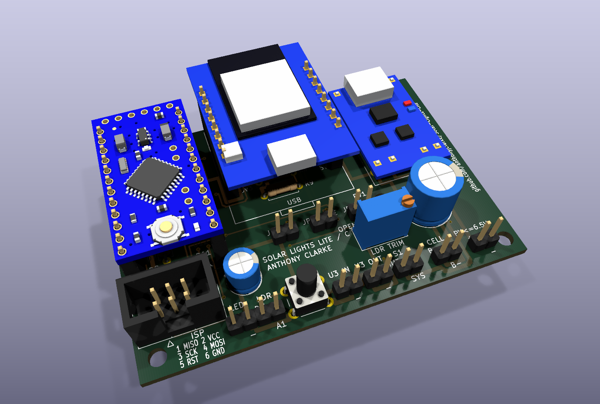
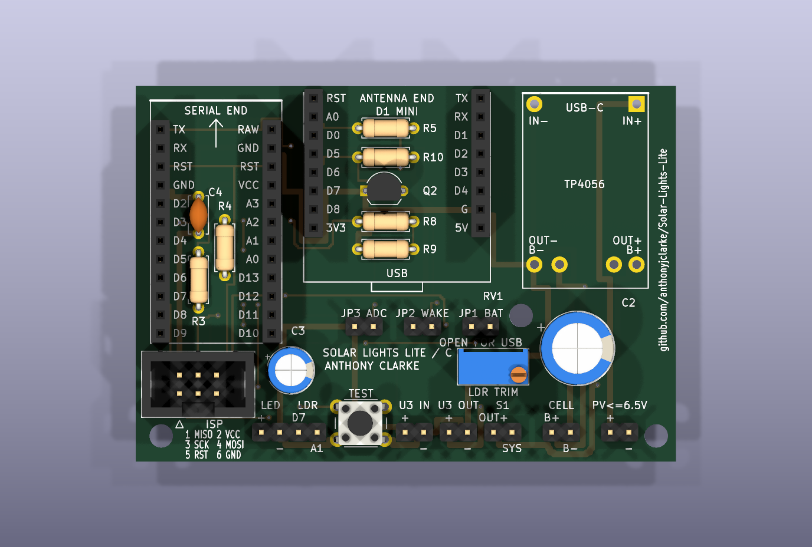
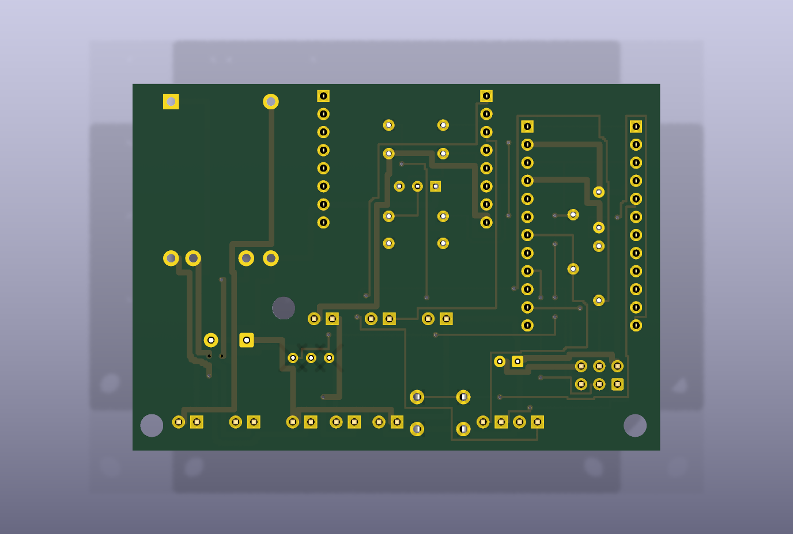
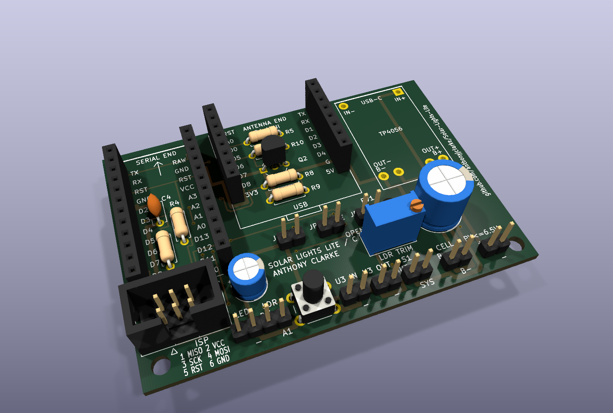
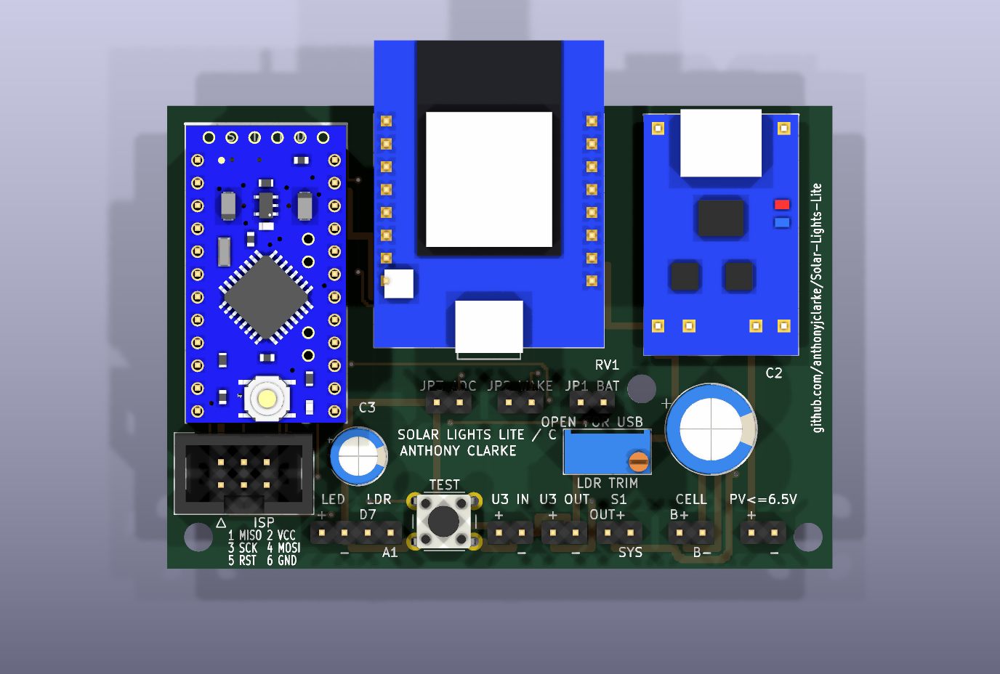
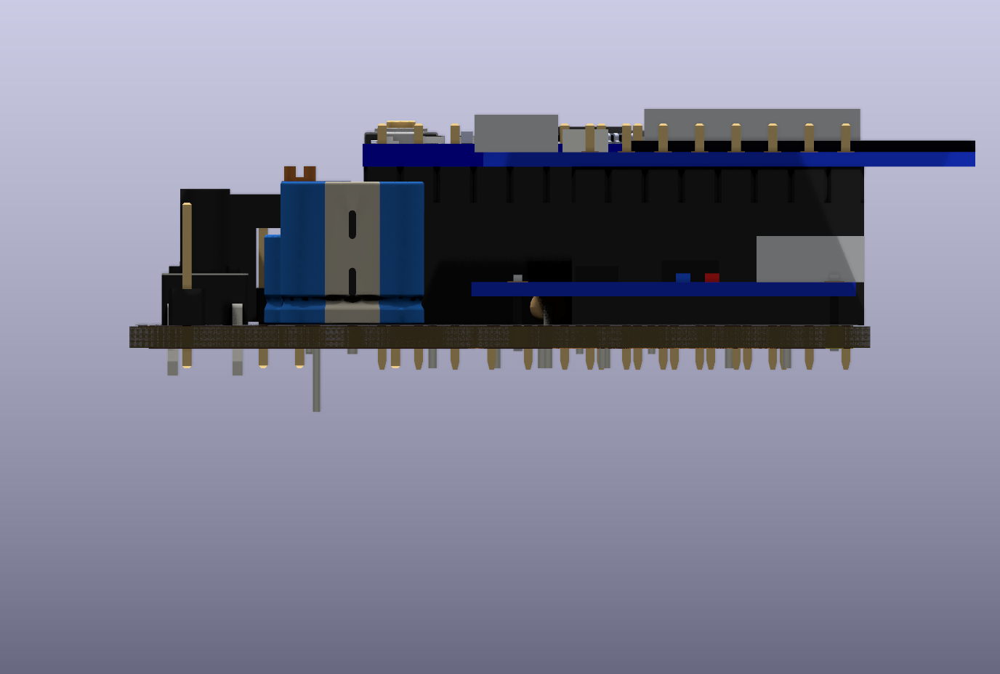

# 13 – PCB carrier

**Design files:** [`hardware/pcb-rev-c/`](../hardware/pcb-rev-c/) (KiCad 10).
**Fit check:** [`fit-sheet-A4.pdf`](../hardware/pcb-rev-c/review/fit-sheet-A4.pdf).
**Review pack:** [`pcb-review.pdf`](../hardware/pcb-rev-c/review/pcb-review.pdf).

The carrier PCB replaces the perfboard from guides 04–07. The Pro Mini (M2)
and D1 Mini (M3) plug into sockets, and the TP4056 charger (M1) solders
directly onto the board. The TEST button and the RV1 dusk trimmer are on the
board too, and every other external connection is a 2.54 mm pin header. The
circuit, firmware and ESPHome configuration are the same as in the wired
build, so modules A–F, tiers 0/1/2 and gates 0–8 all still apply.

Rev C is the current design. It has passed the CAD checks but has not been
fabricated yet; Rev B, the board that was ordered, is described at the end.

**What you will learn:** how to read a two-layer board, check that a board
fits before you order it, order bare boards from a fabrication service,
assemble through-hole parts in a sensible order, and test a populated board
before any module goes in.

*Rev C fully assembled: Pro Mini (left) and D1 Mini (centre) in their
sockets, TP4056 charger (right) on wire links, the ISP box header below the
Pro Mini, RV1 and the TEST button along the bottom, and pin headers on every
connection. See [About the renders](#about-the-renders) for which module
models are exact.*

---

## The board at a glance

| Item              | Rev C                                             |
|:------------------|:--------------------------------------------------|
| Size              | 74 × 51.5 mm, two layers, 1.6 mm FR-4, 1 oz       |
| Parts             | All through-hole; no SMD soldering                |
| M2 Pro Mini       | Two 12-way sockets, serial-header end up          |
| M3 D1 Mini        | Two 8-way sockets; antenna overhangs the top edge |
| M1 TP4056         | Six wire links through overlay holes, USB-C up    |
| External links    | Seven 2-pin headers along the bottom edge         |
| On-board controls | SW1 TEST button, RV1 dusk trimmer                 |
| Tier links        | JP1–JP3, 2-pin headers with shunts                |
| Programming       | `JISP1` 2 × 3 ISP, optional keyed box header      |
| Mounting          | Three 3.2 mm holes, no copper near them           |
| Assembled height  | About 15 mm above the board, 3 mm of leads below  |
| Overhang          | D1 Mini antenna about 7.3 mm past the top edge    |

The silkscreen shows each module's true outline, with its pin names beside
every socket hole. That makes a reversed module easy to spot. Turning M2 or
M3 through 180° puts signals on the wrong pins, so always match the module
to the outline and the `SERIAL END` / `ANTENNA END` marks.

The silkscreen also carries the author's name and, running up the right-hand
edge beside the TP4056, the repository address
`github.com/anthonyjclarke/Solar-Lights-Lite`.

---

## Design decisions

- **B– is not ground.** On the board, `PACK_NEG` (B–) is its own net and
  never joins `GND_LOAD`. Only M1 OUT– is the load return, exactly as in
  guide 03.
- **The antenna overhangs the board.** M3's antenna end sticks out past the
  top edge, so there is no copper under it. The cost is that M3's
  micro-USB faces into the board. A right-angle micro-USB adapter, or
  ESPHome over-the-air updates, avoids the tight spot above JP2/JP3.
- **There are no fuses on the board.** Fit the cell fuses FB1/FB2 inline at
  the cell holder as in [guide 03, step 3](03-build-power.md#3-prepare-the-cells).
  The copper between `JCELL1` and M1 is upstream of the module's protection,
  so a bridge there shorts the cells directly. For F2, fit a 1 A inline fuse
  in the S1 lead.
- **Small parts sit under the modules.** R3, R4 and C4 are under M2; R5, R8,
  R9, R10 and Q2 are under M3. With 8.5 mm sockets there is about 6 mm of
  room, so keep these parts seated flat and low.
- **Controls sit where you can reach them.** RV1 and SW1 are clear of both
  modules, so you can trim the dusk level and run the TEST without
  unplugging anything. RV1 is a multi-turn 3296W trimmer in series with R4
  (see [guide 06](06-build-sensor.md#how-the-sensor-works)).
- **The ISP header lies on its side below the Pro Mini.** Its outline is a
  DC3-6P box header, so a keyed 6-pin IDC cable or a 2 × 3 adapter plugs in
  without touching M2. The pin names are printed underneath it, because the
  box covers the board beside the pins.
- **U0 and U3 stay off the board.** Each one connects through its own pair of
  pins: `PV` for U0's 5 V output and `U3 IN` / `U3 OUT` for U3.

*Bottom view, mirrored as seen from underneath.*

---

## Connections

Pin 1 of every pair is on the left, on the square pad.

| Header     | Pin 1         | Pin 2       | Connects to                        |
|:-----------|:--------------|:------------|:-----------------------------------|
| `JLED1`    | LED +         | –           | Low-power LED string               |
| `JLDR1`    | D7 supply     | A1 sense    | Remote LDR across the two pins     |
| `JU3IN1`   | `VBAT_SYS`    | –           | U3 input (Tier 2)                  |
| `JU3OUT1`  | U3 3.3 V      | –           | U3 output (Tier 2)                 |
| `JS1`      | M1 OUT+       | `VBAT_SYS`  | S1 service switch                  |
| `JCELL1`   | B+            | B–          | Fused 1S2P cells                   |
| `JPV1`     | Charger 5 V   | Charger –   | U0 output, or an Option A panel    |

| Tier | Fit                                       | JP1             | JP2           | JP3                  |
|:-----|:------------------------------------------|:----------------|:--------------|:---------------------|
| 0    | M1, M2, C3, C4, R3, R4, RV1, SW1, headers | Open            | Open          | Open                 |
| 1    | Add M3, Q2, R5, R8, R9, R10               | **Open**        | Open to flash | Closed while powered |
| 2    | Add C2 and U3 wiring; production firmware | Closed, no USB  | Closed        | Closed               |

JP1 decides where M3's 3.3 V comes from: open, M3 runs from its own USB;
closed, U3 feeds it from the battery. There is no automatic interlock between
USB and battery power. Never close JP1 while M3 is powered from USB. Remove
JP3 whenever M3 is unpowered.

---

## Before you order

1. Print [`fit-sheet-A4.pdf`](../hardware/pcb-rev-c/review/fit-sheet-A4.pdf)
   at **100 %** (scaling off) and check the 50 mm calibration line.
2. Lay the real M2, M3 and M1 on the sheet. Every pin and hole should sit
   on its printed mark, with the D1 Mini's antenna end up and the TP4056's
   USB-C end up.
3. Upload `SolarLights_Carrier_RevC_fabrication_REVIEW.zip` only. The
   options are 2 layers, FR-4, 1.6 mm, 1 oz copper, HASL (lead-free if
   offered), any mask colour, top silkscreen, no assembly.
4. Compare the fabrication service's preview with
   [the top render](images/pcb/carrier-top.png): outline, three mounting holes,
   pad names and the square pin-1 pads. The fabrication service's own
   design-for-manufacture check has not been run on Rev C yet.

---

## Parts for the board

The [assembly BOM](../hardware/pcb-rev-c/review/assembly-bom.csv) lists every
reference with its tier. In addition to the values already in
[guide 02](02-parts-and-tools.md):

| Part                                 | Qty | For                      |
|:-------------------------------------|:----|:-------------------------|
| 1 × 12 female socket, 8.5 mm         | 2   | M2 Pro Mini              |
| 1 × 8 female socket, 8.5 mm          | 2   | M3 D1 Mini (Tiers 1, 2)  |
| 1 × 2 male header, 2.54 mm           | 10  | Seven pairs, JP1–JP3     |
| 2 × 3 male header, 2.54 mm           | 1   | `JISP1`                  |
| DC3-6P box header, 2.54 mm, straight | 1   | `JISP1`, optional, keyed |
| 6 × 6 mm tactile switch, tall stem   | 1   | SW1 TEST                 |
| 50 kΩ 3296W trimmer (503)            | 1   | RV1                      |
| 1 × 12 male header, 2.54 mm          | 2   | M2's own pins            |
| 1 × 8 male header, 2.54 mm           | 2   | M3 pins (often supplied) |
| 2.54 mm shunt                        | 3   | JP1–JP3                  |
| Tinned wire or cut resistor leads    | 6   | M1 links                 |
| M3 standoffs and screws              | 3   | Mounting                 |

---

## Assembly

Solder from the lowest parts to the tallest, so each part is held flat by
the bench while you solder it. Check each joint for a shiny fillet on both
sides of the board.

### 1. Resistors

Fit R3 (56 Ω), R4 (22 k) and, for Tiers 1 and 2, R5 (220 k), R8 (47 k),
R9 (100 k) and R10 (10 k). Seat them flat and trim the leads short:
they sit under the modules. Keep two or three cut leads for M1.

### 2. Small capacitor and transistor

Fit C4 (100 nF). For Tiers 1 and 2, fit Q2 (2N3904) with its flat face
matching the outline and E on the square pad. Push it down until the body
is about 2 mm above the board, so M3 clears it.

### 3. Electrolytic capacitors

Fit C3 (100 µF) and, for Tier 2, C2 (470 µF). The stripe marks the
negative lead; the `+` on the silkscreen marks the positive pad.

### 4. Trimmer and button

Set RV1 to mid-travel before fitting: about 25 kΩ between pins 1 and 2.
Fit it with its adjusting screw at the end the outline shows, then fit SW1
flat on the board. Both are clear of the modules.

### 5. Pin headers

Fit the seven bottom-edge pairs, JP1–JP3 and `JISP1`. For `JISP1`, either a
plain 2 × 3 header or the optional DC3-6P box header fits the same holes;
match the box's key slot to the outline, facing the bottom edge. Tack one pin, check
the header is square to the board, then solder the rest. For a permanent
outdoor install, you can solder the cell, PV and S1 wires straight into the
pads instead.

*The board after steps 1–5, with the empty socket positions for M2 and M3
and the outline for M1.*

### 6. Module pins and sockets

The carrier is the jig for both jobs, so the pins and sockets line up:

1. Push the four sockets into their holes. Do not solder them yet.
2. Push the male headers into the sockets, long pins down.
3. Lay the Pro Mini, serial-header end up, on its pins and solder all 24
   from the top. A D1 Mini usually comes with headers: if they are not
   fitted, solder them the same way, antenna end up.
4. With the modules still plugged in, tack one corner pin of each socket
   from underneath, check the sockets sit flat, then solder every socket pin.
5. Unplug the modules for the next steps. Fit the M3 sockets and pins only
   for Tiers 1 and 2.

### 7. TP4056 charger M1

1. Replace the PROG resistor for 100–150 mA
   ([guide 03, step 2](03-build-power.md#2-set-the-charge-current)) before
   fitting the module.
2. Meter the module: IN– to OUT– is usually joined, and B– must not be
   joined to OUT–.
3. Push a cut lead through each of the six module holes and its carrier hole.
   Stand the module about 2 mm proud, with USB-C at the top edge.
4. Solder each link on both boards, then trim it.

### 8. Inspect and clean

Inspect every joint with a loupe, especially between the close pins of M1's
bottom row (OUT–, B–, B+, OUT+). Clean off flux. A conformal coating over
the bottom side, away from the sockets and headers, protects the unfused
cell copper from moisture.

---

## Test before the modules go in

With M2 and M3 out and nothing connected, measure with a meter:

- [ ] No short between `VBAT_SYS` (`JS1` pin 2) and any `–` pin.
- [ ] No short between B+ and B– at `JCELL1`.
- [ ] B– (`JCELL1` pin 2) is **not** joined to any `–` pin.
- [ ] `JS1` pin 1 and pin 2 are not joined: S1 open isolates the rail.
- [ ] JP1 and JP3 pins are not joined without their shunts.
- [ ] D2 (M2 socket) to `–` reads open, and closed while SW1 is pressed.
- [ ] M2 socket A1 to `–` reads 22–72 kΩ, depending on RV1.
- [ ] M2 socket VCC to `VBAT_SYS`, and M2 socket GND to `–`, are continuous.

Then fit M2 (serial-header end up) and program it in circuit through
`JISP1`. Open S1 first. Use 3.3 V signalling, and either set the programmer
to supply no power or keep S1 open while it does
([guide 08](08-firmware.md#wire-the-programmer)).

From here, follow the gates in [commissioning](10-commissioning.md) exactly
as for the wired build: Gate 0 inspection, Gate 1 on a bench supply, and so on.
For Tiers 1 and 2, fit M3 antenna end up, matching the outline.

---

## Final assembly

Plug each module fully home, so its header spacer sits on the socket:

- **M2 Pro Mini:** serial-header end towards the `SERIAL END` mark.
- **M3 D1 Mini:** antenna end overhanging the top edge, USB end over JP1–JP3.
- **M1 TP4056:** already soldered on its links, USB-C at the top edge.

From the side, the modules stand about 11 mm above the board on their
socket and header spacer, which leaves room for the parts underneath. The
D1 Mini's antenna overhangs the top edge. Allow about 15 mm of height above
the board, 3 mm of leads below it, and space past the top edge for the
antenna in the enclosure.

*Side view from the right-hand edge: TP4056 on its links (front), D1 Mini
on its sockets with the antenna overhanging the top edge (left).*

---

## What can go wrong

| Symptom                                   | Likely cause                                          |
|:------------------------------------------|:------------------------------------------------------|
| Programmer cannot read the signature      | M2 reversed; S1 closed with programmer power; 5 V I/O |
| D1 Mini or U3 damaged                     | M3 turned 180°, or JP1 closed with USB connected      |
| Battery reading wrong or stuck            | JP3 open, or R5 / R9 values swapped                   |
| No telemetry lines                        | Q2 reversed (E must be on the square pad)             |
| Module will not seat                      | Q2, C4 or a resistor standing too tall under it       |
| Cells drain with the switch open          | Bridge between B+ / B– copper; clean and re-inspect   |
| IDC programming cable will not go in      | Key does not match the box header's slot (bottom edge) |
| Lights come on too early or too late      | RV1 setting: see guide 06, calibrate in place         |

---

## About the renders

The images are generated by `hardware/pcb-rev-c/tools/make_doc_renders.py`
from the KiCad board, with standard KiCad models for the pin headers, the
box header, the trimmer and the button.

- **Pro Mini:** the
  [SnapEDA Arduino Pro Mini](https://www.snapeda.com/parts/Arduino%20Pro%20Mini/Arduino/view-part/)
  model (CC BY-SA 4.0, credit SnapEDA). It follows the SparkFun layout. The
  pin positions match the carrier, but the reference BTE13-010A clone places
  its parts differently.
- **D1 Mini and TP4056:** simple stand-in models built from the measured
  outlines and pin positions. They are right for size, pins and height,
  not for detail.

[`hardware/pcb-rev-c/3dmodels/README.md`](../hardware/pcb-rev-c/3dmodels/README.md)
records the sources and how to swap in a real model.

---

## Earlier revisions

[`hardware/pcb-rev-b/`](../hardware/pcb-rev-b/) is the board that was
ordered, kept unchanged as the record. It has the same outline and modules
as Rev C, with these differences: R3 is 47 Ω and R4 is 47 kΩ with no
trimmer; the test button is a pair of pins for a remote switch; the ISP
header stands upright against the end of the Pro Mini, so an IDC plug does
not fit; and mounting hole H1 is 0.5 mm higher. On a Rev B board, fit R3 as
56 Ω if the string draws over 20 mA at 4.20 V.

[`hardware/pcb-rev-a/`](../hardware/pcb-rev-a/) is an earlier 100 × 80 mm
carrier. It has screw terminals and fuse F2 on the board, but M1 and the
cell fuses stay off it. It remains for reference only.
